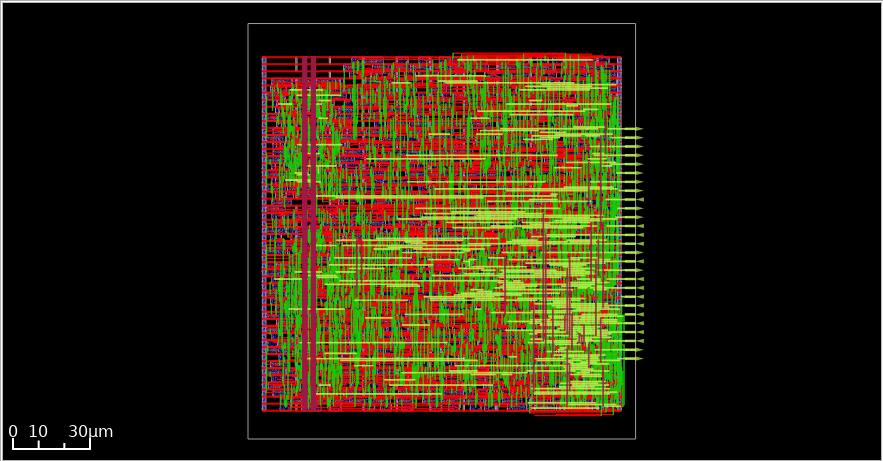

# UART FIFO ASIC Flow

This project is an 8-bit UART transmitter and receiver with a FIFO on each side. This folder contains the SystemVerilog design, testbenches, and scripts for simulation and an ASIC backend flow using the SkyWater SKY130 process.

## Design overview

The top-level module is `uart` in `src/uart.sv`. Its default parameters are:

| Parameter | Default | Description |
| --- | ---: | --- |
| `clk_freq` | 50 MHz | Input clock frequency |
| `baud_rate` | 115200 bit/s | UART data rate |

Important FIFO and UART signals:

- `we`: write `tx_data_in` to the transmit FIFO.
- `re`: read the next byte from the receive FIFO.
- `full_tx`, `empty_tx`, `full_rx`, `empty_rx`: FIFO status signals.
- `tx_active`: indicates that the transmitter is sending data.
- `tx`, `rx`: serial transmit and receive signals.
- `rst`: synchronous reset.

Main RTL files:

- `src/uart.sv`: connects the UART blocks.
- `src/transmitter.sv`, `src/uart_tx.sv`: transmit FIFO and serial transmitter.
- `src/receiver.sv`, `src/uart_rx.sv`: serial receiver and receive FIFO.
- `src/FIFO.sv`: shared byte FIFO.

## UART layout

The image below shows the physical layout created by the ASIC backend flow.



## Simulation

Run the top-level testbench with Questa or ModelSim from the `src` folder:

```bash
cd designs/uart/src
vsim -c -do run_uart_tb.do
```

The `uart_tb.sv` testbench connects `tx` to `rx`, sends test bytes through the transmit FIFO, and checks the received data. A successful run prints `===== PASS =====`. You can also open Questa GUI and run the same `.do` file with `vsim -do run_uart_tb.do`.

Separate testbenches for the FIFO, receiver, and transmitter are in `src/testbench/`.

## ASIC backend flow (SKY130)

The backend flow uses Yosys for synthesis and OpenROAD for floorplanning, placement, clock-tree synthesis (CTS), and routing. Magic and Netgen are used for GDS generation, DRC, and LVS.

The main backend settings are defined in `scripts/00_setup.tcl`:

| Setting | Value | What it means |
| --- | --- | --- |
| PDK | `sky130A` | The SKY130 process design kit |
| Standard-cell library | `sky130_fd_sc_hd` | The cells used to build the digital circuit |
| Timing corner | `tt_025C_1v80` | Typical process, 25°C, and 1.80 V |
| Clock period | 20 ns (50 MHz) | The target period for the `clk` signal |
| Input/output delay | 4 ns (20% of the clock period) | Time reserved for signals entering and leaving the chip |
| Core utilization | 50% | Target portion of the core area occupied by cells |
| Aspect ratio | 1 | The core is planned to be square |
| Placement density | 0.624063 | Target density used by the placer |
| Maximum fanout | 10 | Maximum number of loads driven by a signal |
| Clock uncertainty | 0.25 ns | Timing margin for clock variation |
| CTS cluster size | 10 | Target number of sinks in a clock-tree cluster |
| Routing layers | `met1` to `met5` | Metal layers available for signal and clock routing |

These are flow targets and constraints; the final layout and timing results can vary between runs.

### Requirements

- Docker and the image `ghcr.io/efabless/openlane2:2.3.10`.
- The SKY130 PDK, including standard cells, LEF, Liberty, and technology files for OpenROAD, Magic, and Netgen.
- Python 3 to create the metrics report.

### Running the flow

`scripts/flow_all.sh` is a **manual guide**, not an automated script. Running the file directly only prints a message and exits. Open it and run each command block manually with the listed tool. The flow includes synthesis, floorplanning, placement, CTS, routing, final checks, GDS generation, DRC, extraction, LVS, and metrics generation.

Helper scripts in `scripts/`:

- `run_synth.sh`: runs Yosys with `synth.ys` in Docker.
- `run_step.sh`: runs a Tcl script with the selected tool.
- `run_gui.sh`: opens the OpenROAD GUI.
- `make_metrics.py`: reads available DEF files and reports to create `results/metrics.csv`.

> **Path note:** The scripts and commands currently use absolute paths from the development machine (for example, `/home/thu/...`), including the PDK path. Before running on another machine, update these paths and check `PDK_ROOT`, Docker mounts, the SKY130 library, and tool versions.

Use a separate folder under `runs/` for each flow run, with `results/` and `reports/` subfolders. The guide uses `designs/uart/run` to point to the current run. Keep old run folders if you want to compare results.

## Folder structure

```text
designs/uart/
├── README.md
├── scripts/       # Helper scripts and the manual flow guide
├── src/           # RTL, testbenches, and Quartus files
├── runs/          # Results from ASIC flow runs
└── archive_old/   # Older flow settings and results
```
